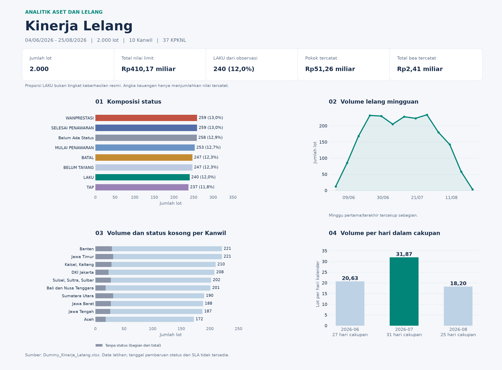

# Dashboard Kinerja Lelang: penjelasan dan langkah pembuatan

## 1. Tujuan dan sumber

Dashboard membantu pimpinan membaca volume lelang, komposisi status, perbandingan wilayah, nilai portofolio, durasi proses, dan area yang perlu ditelaah. Implementasi mengikuti instruksi **Studi_Kasus_Visualisasi_Data_dengan_Python_Aset_dan_Lelang.pdf**, khususnya pertanyaan analitik pada halaman 3, pengolahan pada halaman 6-8, struktur dashboard pada halaman 9, serta keluaran dan narasi pada halaman 10-11.

Sumber angka adalah **Dummy_Kinerja_Lelang.xlsx**, sheet **RAW Kinerja Lelang**. Workbook asli tetap utuh; proyek memakai salinannya di `data/`. Tidak ada data eksternal atau angka sintetis tambahan.

| Karakteristik | Hasil pemeriksaan |
|---|---:|
| Observasi | 2.000 baris |
| Variabel asli | 30 |
| Kanwil | 10 |
| KPKNL | 37 |
| Jenis lelang | 10 |
| Periode tanggal lelang | 4 Juni-25 Agustus 2026 |
| Kode lot duplikat | 0 |
| Status lelang kosong | 258 observasi |
| Pokok lelang kosong | 1.760 observasi |

**Batas interpretasi:** data merupakan bahan latihan, bukan kinerja resmi. Status proses, pembatalan, TAP, dan status kosong tidak otomatis diperlakukan sebagai outcome final. Arti TAP serta definisi status final harus dikonfirmasi kepada pemilik proses. Tidak tersedia tanggal pembaruan status ataupun SLA.

## 2. Pertanyaan analitik yang dijawab

| No. | Pertanyaan | Visual atau keluaran |
|---|---|---|
| 1 | Berapa jumlah lot, nilai limit, lot LAKU, pokok lelang, dan total bea tercatat? | Lima kartu KPI |
| 2 | Bagaimana komposisi status, termasuk status kosong? | Bar horizontal dengan jumlah dan persentase |
| 3 | Apakah komposisi status berbeda antarjenis lelang? | Heatmap persentase per jenis, dengan denominator n |
| 4 | Kanwil mana memiliki volume besar dan banyak status yang perlu diverifikasi? | Stacked bar volume dan status per Kanwil |
| 5 | KPKNL mana perlu ditelaah dari sisi volume, proporsi LAKU, kelengkapan status, dan nilai limit? | Bubble chart dan tabel perbandingan KPKNL |
| 6 | Bagaimana pola volume dari waktu ke waktu? | Line chart mingguan/bulanan dan tabel hari cakupan |
| 7 | Bagaimana sebaran nilai limit dan perbedaannya antarkategori aset? | Histogram dan boxplot |
| 8 | Bagaimana durasi penetapan, penayangan, dan pelaksanaan lelang? | Boxplot tiga interval waktu |
| 9 | Data mana yang kosong dan bagaimana pengaruhnya pada pembacaan KPI? | Grafik ketersediaan data dan diagnostik |
| 10 | Apa tiga temuan, makna, dan tindakan yang dapat dibahas dalam rapat? | Tiga narasi What-So What-Now What dan usulan penanggung jawab |

## 3. Hasil yang dibuat

| File | Kegunaan |
|---|---|
| `src/app.py` | Dashboard Streamlit satu halaman dengan enam tab, Light/Dark, filter, dan unduhan |
| `src/ui.py` | Palet Light/Dark, penyesuaian grafik, dan tabel baca yang mengikuti tema |
| `src/analysis.py` | Pembacaan data, variabel turunan, agregasi, pemeriksaan, dan narasi |
| `src/charts.py` | Sembilan grafik Plotly yang dipakai bersama oleh aplikasi dan HTML |
| `src/exploration.py` | Membuat ulang laporan HTML, grafik PNG, ringkasan visual, CSV, dan JSON |
| `output/dashboard_lelang.html` | Laporan seluruh dataset yang dapat dibuka langsung di browser tanpa internet |
| `output/ringkasan_visual.png` | Ringkasan visual untuk dibaca atau dimasukkan ke presentasi |
| `output/grafik/01_status.png` hingga `09_kualitas.png` | Grafik terpisah untuk laporan atau presentasi |
| `output/detail_lelang.csv` | Detail operasional seluruh dataset, tanpa kolom identitas pribadi |
| `output/ringkasan_kanwil.csv` dan `ringkasan_kpknl.csv` | Angka pembanding per wilayah/unit |
| `output/ringkasan_bulanan.csv` | Jumlah lot, hari cakupan, dan lot per hari kalender |
| `output/ketersediaan_data.csv` | Jumlah dan persentase nilai kosong |
| `output/ringkasan_analisis.json` | KPI, hasil pemeriksaan, dan narasi yang dapat dibaca kembali secara terstruktur |
| `jalankan_dashboard.bat` | Peluncur dashboard di Windows |
| `requirements.txt` | Daftar pustaka yang diperlukan |
| `requirements-lock.txt` | Versi pasti seluruh dependensi yang dipasang dan diuji |
| `environment.yml` | Alternatif environment Conda dengan Python 3.12 |
| `setup_environment.bat` | Penyiapan environment `.venv` di Windows |
| `PANDUAN_ENVIRONMENT.md` | Langkah pemasangan, aktivasi, dan pemeriksaan environment |
| `tests/` | Pengujian hitungan dan perilaku aplikasi |

HTML mendukung hover, zoom, klik legenda, unduh gambar, dan pencarian tabel. **Filter lintas KPI dan grafik tersedia pada aplikasi Streamlit.** Pencarian tabel pada HTML hanya menyaring baris tabel; cakupan grafik HTML tetap seluruh dataset.



## 4. Langkah-langkah pembuatan

### Langkah 1: membaca kebutuhan pada PDF

Kebutuhan dipetakan menjadi tiga bagian halaman: **gambaran umum**, **diagnosis**, dan **tindak lanjut**. Setiap grafik memiliki satu pertanyaan utama. Hasil harus mencakup KPI, bar chart, line chart, distribution chart, comparison chart, filter, tabel detail, serta tiga temuan dan tiga rekomendasi.

### Langkah 2: menyiapkan struktur proyek

```text
visualisasi-lelang/
├── data/
│   └── Dummy_Kinerja_Lelang.xlsx
├── src/
│   ├── analysis.py
│   ├── charts.py
│   ├── ui.py
│   ├── exploration.py
│   └── app.py
├── output/
│   ├── dashboard_lelang.html
│   ├── ringkasan_visual.png
│   ├── grafik/
│   ├── detail_lelang.csv
│   └── ringkasan_*.csv / ringkasan_analisis.json
├── tests/
├── .streamlit/config.toml
├── requirements.txt
├── requirements-lock.txt
├── environment.yml
├── setup_environment.bat
├── jalankan_dashboard.bat
├── PANDUAN_ENVIRONMENT.md
├── README.md
└── PENJELASAN_DAN_LANGKAH.md
```

### Langkah 3: menyiapkan Python

Untuk menjalankan di komputer lain, pasang Python 3.12 atau lebih baru. Buka terminal di folder proyek, kemudian jalankan:

```powershell
python -m venv .venv
.\.venv\Scripts\python.exe -m pip install -r requirements-lock.txt
.\.venv\Scripts\python.exe -m pip check
```

Pustaka utama adalah Pandas dan NumPy untuk pengolahan, OpenPyXL untuk membaca Excel, Plotly untuk grafik, dan Streamlit untuk dashboard. Matplotlib membuat ringkasan visual PNG. Kaleido mengekspor grafik Plotly ke PNG dan memerlukan Chrome/Chromium. Internet hanya diperlukan saat pemasangan pustaka, bukan saat membaca dashboard dari data lokal.

File `src/app.py` menggunakan keempat import yang diminta:

```python
import streamlit as st
import pandas as pd
import plotly.express as px
from pathlib import Path
```

`st` membangun komponen dashboard, `pd` menangani tabel dan data, `px` menetapkan tema Plotly Express serta menjadi pustaka grafik pada `src/charts.py`, dan `Path` menentukan lokasi workbook relatif terhadap folder proyek. Beberapa grafik khusus memakai Plotly Graph Objects untuk mengatur segmen, label, dan hover secara lebih rinci.

Pada komputer tempat proyek ini dibuat, environment `.venv` disiapkan dengan Python 3.12. Peluncur menggunakan Python dari environment tersebut. Untuk membuat ulang environment, gunakan `setup_environment.bat` atau perintah di atas. Alternatif Conda tersedia melalui `environment.yml`; petunjuk lengkap ada pada [PANDUAN_ENVIRONMENT.md](PANDUAN_ENVIRONMENT.md). Folder environment tidak dimasukkan ke ZIP karena perlu dibuat ulang pada komputer tujuan.

### Langkah 4: membaca data dan memeriksa struktur

Data dibaca dari sheet `RAW Kinerja Lelang`. Pemeriksaan awal mencakup ukuran data, kolom yang diperlukan, nilai kosong, keunikan kode lot, dan tipe data. Baris tidak dibuang hanya karena status atau nilai pokok kosong.

Jumlah lot dihitung sebagai **jumlah observasi setelah filter**. Pada sumber ini terdapat 2.000 kode lot unik sehingga jumlah observasi sama dengan jumlah lot unik. Bila dataset pengganti mempunyai kode duplikat, indikator diagnostik menampilkannya dan sumber perlu direkonsiliasi; aplikasi tidak menebak baris mana yang seharusnya dihapus.

### Langkah 5: mengubah tipe data dan menyiapkan label

- `tgl_penetapan`, `tgl_penayangan`, `tgl_lelang`, dan `tanggal_pelunasan` diubah menjadi timestamp dengan `errors="coerce"`.
- Kolom nilai limit, pokok, dan empat bea diubah menjadi angka. Nilai sumber yang tidak dapat dikonversi ditandai pada diagnostik.
- Spasi di awal/akhir label wilayah, unit, jenis, dan status dibersihkan. Status diseragamkan menjadi huruf besar.
- Status kosong ditampilkan sebagai **Belum Ada Status** pada kolom turunan `status_tampil`. Nilai pada workbook sumber tetap utuh.
- Prefix panjang Kanwil diringkas hanya untuk keperluan label visual.

### Langkah 6: membentuk variabel analitik

Durasi dihitung dengan mempertahankan pecahan hari:

```python
hari_penetapan_tayang = (tgl_penayangan - tgl_penetapan).total_seconds() / 86400
hari_tayang_lelang = (tgl_lelang - tgl_penayangan).total_seconds() / 86400
hari_penetapan_lelang = (tgl_lelang - tgl_penetapan).total_seconds() / 86400
```

Implementasi pada data kolom menggunakan accessor `.dt.total_seconds()`. Durasi negatif ditandai dan dikeluarkan dari distribusi, tanpa menghapus baris lot. Pada sumber ini tidak ditemukan durasi negatif. Median penetapan ke lelang adalah **27,46 hari kalender**.

Kategori aset diturunkan dari `nama_lot` dengan urutan aturan yang sama seperti PDF:

| Kata kunci | Kategori |
|---|---|
| `tanah` | Tanah/Bangunan |
| `kendaraan roda empat` | Kendaraan Roda 4 |
| `kendaraan roda dua` | Kendaraan Roda 2 |
| `barang inventaris` | Barang Inventaris |
| Tidak cocok | Lainnya |

Kategori mengikuti teks sumber. Kesesuaian deskripsi atau merek kendaraan tidak diverifikasi secara eksternal. Kategori turunan bukan pengganti klasifikasi resmi aset.

### Langkah 7: mendefinisikan KPI dan denominator

| KPI | Rumus | Hasil seluruh dataset |
|---|---|---:|
| Jumlah lot | Jumlah baris | 2.000 |
| Total nilai limit | Jumlah `nilai_limit` tersedia | Rp410.171.717.355 |
| Lot LAKU | Jumlah `status_tampil == "LAKU"` | 240 |
| Proporsi observasi LAKU | 240 / 2.000 × 100% | 12,0% |
| Pokok lelang tercatat | Jumlah `pokok_lelang` tersedia | Rp51.258.617.539 |
| Total bea tercatat | Jumlah empat komponen bea yang tersedia | Rp2.413.656.000 |
| Median nilai limit | Median `nilai_limit` tersedia | Rp95.474.304,50 |
| Status kosong | 258 / 2.000 × 100% | 12,9% |

Empat komponen total bea:

| Komponen | Jumlah tercatat |
|---|---:|
| Bea permohonan | Rp300.000.000 |
| Bea batal | Rp63.300.000 |
| Bea lelang pembeli | Rp1.025.178.000 |
| Bea lelang penjual | Rp1.025.178.000 |
| **Total** | **Rp2.413.656.000** |

Penjumlahan memakai `min_count=1`. Jika seluruh pokok pada cakupan filter kosong, aplikasi menampilkan **Tidak tersedia**, bukan Rp0. Nilai kosong tidak diimputasi menjadi nilai transaksi nol. Total bea adalah jumlah komponen yang tercatat, bukan jaminan kelengkapan pencatatan ataupun verifikasi kas masuk.

Pokok tersedia pada seluruh **240 lot LAKU** dan kosong pada **1.760 lot berstatus lainnya atau kosong**. Karena itu, 88% pokok kosong tidak langsung ditafsirkan sebagai 88% kesalahan data.

Proporsi LAKU memakai **seluruh observasi terpilih** sebagai denominator. Saat filter status LAKU digunakan, proporsinya menjadi 100% dari subset tersebut. Angka tersebut tetap bukan tingkat keberhasilan resmi; aplikasi menampilkan pengingat ketika filter status aktif.

### Langkah 8: membuat visualisasi

1. **Bar status:** label jumlah dan persentase dibaca langsung; LAKU, WANPRESTASI, BATAL, dan status kosong memiliki warna yang konsisten.
2. **Line chart waktu:** pilihan mingguan membantu melihat pola yang tidak tampak pada tiga titik bulanan. Bulan/minggu pada tepi data diberi catatan cakupan sebagian.
3. **Stacked bar Kanwil:** menampilkan total volume sekaligus susunan status. Kelompok “Status lainnya” hanya pengelompokan tampilan, bukan definisi outcome akhir.
4. **Heatmap jenis lelang:** menggunakan persentase per baris agar komposisi antarjenis dapat dibandingkan; n tetap ditampilkan agar ukuran kelompok diketahui.
5. **Bubble chart KPKNL:** sumbu x = volume, sumbu y = proporsi observasi LAKU, ukuran = nilai limit, warna = proporsi tanpa status. Tidak memakai kuadran atau skor kinerja yang tidak memiliki dasar bisnis.
6. **Histogram limit:** memakai skala Rp juta dan garis median; distribusi tidak direduksi menjadi satu total.
7. **Boxplot kategori aset:** membandingkan median dan rentang tengah nilai. Titik ekstrem tidak digambar agar terbaca, tetapi tetap masuk perhitungan.
8. **Boxplot durasi:** membandingkan tiga interval proses. Selisih durasi tidak otomatis membuktikan bottleneck atau pelanggaran SLA.
9. **Bar ketersediaan:** menampilkan jumlah kosong beserta denominator sehingga pembaca dapat menilai batas angka yang ditampilkan.

Pada boxplot, kotak menunjukkan kuartil 25-75%, garis tengah adalah median, dan whisker mengikuti batas 1,5 IQR. Semua grafik memiliki keterangan satuan dan konteks denominator yang relevan.

### Langkah 9: merakit dashboard Streamlit

Navigasi di bagian atas terdiri dari enam tab: **Ringkasan**, **Wilayah**, **Aset**, **Proses & Data**, **Tindak Lanjut**, dan **Detail Lot**. Setiap tab menampilkan analisis yang dipilih, sehingga pembaca tidak perlu melewati sembilan grafik dalam satu halaman panjang. Tab Wilayah mempunyai tiga pilihan: Kanwil, KPKNL, dan Jenis Lelang. Kartu KPI berada pada Ringkasan agar tab lain langsung memperlihatkan analisisnya.

Pilihan **Tampilan: Light/Dark** tersedia di kanan atas. Warna latar, teks, kartu, filter, tabel, grid, serta hover grafik disesuaikan melalui palet di `src/ui.py`. Pemilihan tema disimpan per sesi dan tidak mengubah sumber data atau cakupan filter. Mode awal adalah Light; pilihan tetap dipertahankan ketika berpindah tab atau mengubah filter selama sesi tersebut.

Filter tersedia untuk tanggal lelang, Kanwil, KPKNL, jenis lelang, kategori aset, dan status. Pilihan kategori kosong berarti semua kategori. Pilihan KPKNL mengikuti Kanwil; pilihan unit yang tidak lagi cocok otomatis dibersihkan.

Semua KPI, grafik, narasi, tabel wilayah, dan detail dihitung dari subset yang sama. Tanggal akhir mencakup seluruh hari hingga sebelum pukul 00.00 hari berikutnya, sehingga lot pada sore atau malam hari tidak terlewat. Bila tidak ada hasil, aplikasi memberi pesan dan menyediakan tombol atur ulang.

Tabel detail hanya menampilkan kolom operasional yang diperlukan. Nama pribadi, NIP, nama debitur, dan kontak tidak dimasukkan ke tabel atau CSV hasil. Pencarian kode lot hanya menyaring tabel dan unduhannya; hal ini dijelaskan di dekat tabel. Tabel ditampilkan 50 baris per halaman dengan header melekat dan area gulir terbatas. CSV tetap memuat seluruh hasil filter dan pencarian, bukan hanya halaman tabel yang sedang terlihat.

Tab menggunakan `st.tabs(..., key="halaman", on_change="rerun")` dan properti `.open` sehingga hanya konten tab aktif yang dibuat. Implementasi ini mengikuti [dokumentasi resmi st.tabs](https://docs.streamlit.io/develop/api-reference/layout/st.tabs). Tabel baca dirender dengan HTML yang di-escape melalui Pandas dan disanitasi oleh [st.html](https://docs.streamlit.io/develop/api-reference/text/st.html), agar warna header dan sel mengikuti pilihan tampilan. Tidak ada JavaScript tambahan atau pustaka baru untuk pemilihan tema.

### Langkah 10: menjalankan dan membuat ulang hasil

```powershell
# Dashboard dengan seluruh filter
.\.venv\Scripts\python.exe -m streamlit run src/app.py

# HTML, PNG, CSV, dan JSON seluruh dataset
.\.venv\Scripts\python.exe src/exploration.py

# Ekspor tanpa PNG grafik Plotly jika Chrome belum tersedia
.\.venv\Scripts\python.exe src/exploration.py --skip-chart-png

# Memeriksa hitungan dan interaksi aplikasi
.\.venv\Scripts\python.exe -m unittest discover -s tests -v
```

Untuk memperbarui data, ganti workbook pada `data/` dengan file yang mempunyai nama, sheet, dan kolom yang sama. Streamlit membaca ulang ketika waktu modifikasi file berubah. Jalankan kembali `exploration.py` agar HTML, CSV, JSON, dan gambar mengikuti data baru. Angka dalam dokumen penjelasan ini merupakan hasil dataset awal dan perlu diperbarui saat sumber berubah.

## 5. Pengembangan dibanding contoh PDF

| Contoh awal | Pengembangan | Manfaat bagi pembaca |
|---|---|---|
| Bar status satu warna | Warna status konsisten, jumlah, dan persentase | Outcome dan kelengkapan status lebih mudah ditelaah |
| Volume bulanan tiga titik | Line mingguan/bulanan dan hari cakupan | Pola waktu terbaca tanpa mengabaikan bulan parsial |
| Perbandingan wilayah dari total lot | Komposisi status dan drill-down KPKNL | Menemukan wilayah untuk penelaahan lebih lanjut |
| Agregat jenis lelang | Heatmap komposisi per jenis | Memisahkan ukuran kelompok dari proporsi status |
| Histogram nilai limit tanpa konteks | Satuan Rp juta, median, dan boxplot kategori | Membaca sebaran dan variasi antarkategori |
| Penjumlahan nilai kosong menjadi nol | Agregat tercatat dengan kondisi tidak tersedia | Nilai tidak tersedia tidak terbaca sebagai realisasi nol |
| Grafik terpisah | Alur gambaran umum, diagnosis, dan tindakan | Menghubungkan visual dengan keputusan rapat |
| Halaman panjang | Enam tab utama dan tiga pilihan analisis wilayah | Pembaca langsung memilih analisis tanpa melewati semua grafik |
| Tampilan satu tema | Pilihan Light/Dark di kanan atas | Menyesuaikan kenyamanan baca saat rapat |
| Detail tanpa pembatasan kolom | Detail operasional terpilih dan unduh CSV | Fokus pada kebutuhan analisis dan mengurangi paparan identitas |

## 6. Tiga temuan, makna, dan rekomendasi

Konteks: rapat evaluasi memerlukan gambaran yang dapat ditindaklanjuti, dengan definisi outcome yang disepakati.

### Temuan 1: kelengkapan status membatasi penilaian outcome

**What / temuan:** 258 dari 2.000 lot tidak memiliki status (12,9%). LAKU tercatat pada 240 lot (12,0%). Status proses dan status lain masih tercampur dalam populasi data.

**So what / makna:** denominator untuk tingkat keberhasilan resmi belum ditentukan. Menyebut angka 12,0% sebagai tingkat keberhasilan dapat memberikan interpretasi yang keliru.

**Now what / rekomendasi:** karena terdapat 258 status kosong dan definisi outcome belum disepakati, pengelola data bersama pemilik proses perlu merekonsiliasi status, tanggal pembaruan, serta denominator agar indikator pada rapat mempunyai makna bisnis yang jelas. Hasil yang diharapkan: daftar status terverifikasi dan definisi KPI tertulis.

### Temuan 2: prioritas verifikasi wilayah perlu melihat jumlah dan proporsi

**What / temuan:** Jawa Timur dan Banten sama-sama memiliki volume terbanyak, masing-masing 221 lot. Jawa Timur dan Sumatera Utara sama-sama memiliki 31 status kosong, tetapi proporsinya berbeda: 31/221 = 14,0% dan 31/190 = 16,3%.

**So what / makna:** peringkat jumlah dan proporsi tidak selalu sama. Jumlah berguna untuk memperkirakan pekerjaan verifikasi, sedangkan proporsi membantu membaca kelengkapan pencatatan dalam ukuran populasi masing-masing. Perbedaan ini belum membuktikan mutu kinerja suatu wilayah.

**Now what / rekomendasi:** karena dua wilayah memiliki jumlah status kosong terbesar, koordinator Kanwil dan KPKNL dapat memulai penelusuran daftar lot tersebut, membandingkan jenis lelang dan tahap proses, lalu mencatat penyebab kekosongan agar pembahasan outcome bertumpu pada data yang lebih lengkap. Hasil yang diharapkan: daftar lot dan hasil penelaahan per unit.

### Temuan 3: volume lot tidak cukup untuk menggambarkan konsentrasi nilai

**What / temuan:** 200 lot dengan nilai limit tertinggi (10% observasi) memuat 35,5% total nilai limit. Median nilai limit Rp95,47 juta, sedangkan rata-ratanya sekitar Rp205,09 juta.

**So what / makna:** sebagian lot membawa porsi nilai yang lebih besar daripada porsinya dalam volume. Nilai limit adalah nilai yang tercatat untuk penawaran dan tidak sama dengan penerimaan atau pokok yang terealisasi.

**Now what / rekomendasi:** karena 10% lot membawa 35,5% nilai limit, tim analitik bersama penanggung jawab lot perlu membuat daftar lot bernilai besar untuk mengecek dokumen, jadwal, dan status agar penelaahan pimpinan terarah. Bahas pokok lelang tercatat secara terpisah. Hasil yang diharapkan: daftar prioritas yang memadukan nilai dan kelengkapan informasi.

Narasi dalam aplikasi dihitung ulang mengikuti filter. Dokumen ini menjelaskan cakupan seluruh dataset.

### Catatan tren waktu

| Bulan | Jumlah lot | Hari kalender dalam cakupan | Lot per hari cakupan |
|---|---:|---:|---:|
| Juni | 557 | 27 | 20,63 |
| Juli | 988 | 31 | 31,87 |
| Agustus | 455 | 25 | 18,20 |

Juli mempunyai volume tertinggi pada cakupan tersedia. Juni dimulai tanggal 4 dan Agustus berakhir tanggal 25. Rasio per hari membantu memperjelas jendela pengamatan, tetapi tidak menggantikan data bulan penuh, kalender kerja, atau penjelasan sebab perubahan. Tidak disimpulkan adanya pertumbuhan atau penurunan resmi dari perbandingan bulan parsial ini.

## 7. Rancangan presentasi maksimal lima menit

| Waktu | Bagian | Pesan yang disampaikan |
|---|---|---|
| 00:00-00:35 | Konteks dan cakupan | Data latihan 2.000 lot, 10 Kanwil, 37 KPKNL, tanggal lelang 4 Juni-25 Agustus 2026 |
| 00:35-01:20 | Gambaran umum | Nilai limit Rp410,17 miliar, 240 lot LAKU, pokok tercatat Rp51,26 miliar; jelaskan denominator LAKU |
| 01:20-02:10 | Status dan kualitas | 258 status kosong; tunjukkan mengapa kelengkapan perlu diverifikasi |
| 02:10-03:00 | Wilayah dan jenis | Jawa Timur/Sumatera Utara sebagai titik awal penelaahan; gunakan heatmap dan filter unit |
| 03:00-03:45 | Nilai dan waktu | Konsentrasi nilai pada 10% lot; Juli tertinggi, dua bulan tepi tercakup sebagian |
| 03:45-04:45 | Tindakan | Sepakati definisi KPI, rekonsiliasi status per unit, susun daftar lot bernilai besar |

Sisa 15 detik menjadi ruang transisi. Hindari membaca seluruh tabel; gunakan satu atau dua contoh drill-down untuk memperjelas tindakan.

## 8. Pemetaan persyaratan dan verifikasi

| Persyaratan PDF | Implementasi |
|---|---|
| Minimal lima analytical questions | Sepuluh pertanyaan pada bagian 2 |
| Minimal satu KPI | Lima kartu KPI dan definisi perhitungan |
| Bar chart | Status dan komposisi Kanwil |
| Line chart | Volume mingguan/bulanan |
| Distribution chart | Histogram limit dan boxplot durasi |
| Comparison chart | Heatmap jenis, boxplot aset, bubble chart KPKNL |
| Satu halaman Streamlit | `src/app.py`, enam tab dengan alur overview-diagnosis-action |
| Filter dan detail table | Enam filter, pilihan unit bertingkat, pencarian, unduh CSV |
| Tiga finding, meaning, recommendation | Bagian 6 serta narasi dinamis aplikasi |
| Presentasi maksimal lima menit | Rancangan 4 menit 45 detik pada bagian 7 |
| Interpretasi status dan denominator | Keterangan pada KPI, grafik KPKNL, dan filter status |
| Mengurangi data pribadi | Kolom identitas tidak ditampilkan atau diekspor |

Verifikasi hitungan mencakup rekonsiliasi total nilai dan bea, jumlah status, agregasi wilayah/unit, filter gabungan, tanggal akhir dengan timestamp malam, bulan parsial, durasi pecahan hari, nilai pokok kosong, dan kolom detail. Pengujian aplikasi memeriksa perpindahan Kanwil-KPKNL, pembersihan unit yang tidak cocok, status tanpa pokok, kombinasi tanpa hasil, tombol atur ulang, konten setiap tab, perubahan warna grafik saat mode diganti, pencarian, serta penomoran halaman detail. Klik tab dan retensi pilihan tampilan juga diperiksa langsung di browser. Hasil akhir verifikasi dicatat pada `output/hasil_verifikasi.md`.

Keterbatasan yang tetap perlu dibahas: tanggal snapshot status tidak tersedia, arti outcome final belum dikonfirmasi, nilai kosong tidak selalu merupakan kesalahan, perbandingan unit dipengaruhi komposisi portofolio, dan durasi belum mempunyai SLA pembanding.
